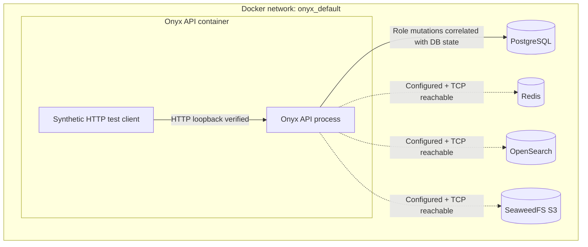

# WP-6.1.2 — Onyx Reference Architecture and Data-Flow Assessment

## 1. Scope and provenance

- Application: Onyx v5.1.3
- Environment: isolated GitHub Codespaces Docker laboratory
- Assessment type: architecture and data-flow discovery
- Runtime source: `3835aa4294198de48d318536081ea09fbde7aea6`
- Report generated UTC: 2026-11-20T20:43:21.596379+00:00
- Separate reference: P-006 Secure-by-Default LLM Application Reference Architecture

This workpaper describes observed and declared architecture.
It is not a production security certification.

## 2. Component inventory

- Declared services: 14
- Running services: 5
- Declared but not running: 9

| Service | Runtime state | Health | Host ports |
|---|---|---|---|
| `api_server` | running | healthy | None published |
| `cache` | running | not_configured | None published |
| `object-store` | running | healthy | None published |
| `opensearch` | running | not_configured | None published |
| `relational_db` | running | healthy | None published |

### Declared services not running

`background`, `code-interpreter`, `indexing_model_server`, `inference_model_server`, `mcp_server`, `minio`, `nginx`, `object-store-copy`, `web_server`

Their absence limits the assessment scope.
It is not, by itself, evidence of a vulnerability.

## 3. Observed deployment architecture

Diagram conventions:
- Solid: application behavior supported by prior 6.1.1 tests.
- Dashed: configured destination and TCP reachability only.
- No browser, frontend, inference or background path is claimed as tested.

## 4. Dependency and data-flow register

| ID | Flow | Evidence | Assessment status |
|---|---|---|---|
| DF-01 | In-container synthetic test client -> API | 6.1.1 live HTTP tests | Verified for tested requests |
| DF-02 | API -> PostgreSQL role changes | HTTP mutation and independent persisted-state checks | Behavior corroborated |
| DF-03 | API -> PostgreSQL (`relational_db:5432`) | TCP reachable; role mutations and persisted state corroborated by 6.1.1 tests | Selected role operations verified; broader database flows untested |
| DF-04 | API -> Redis (`cache:6379`) | Synthetic login, Redis session key and logout behavior observed | Tested session lifecycle verified; broader Redis operations untested |
| DF-05 | API-container test client -> OpenSearch (`opensearch:9200`) | Direct authenticated metadata requests succeeded | Client-to-service boundary verified; Onyx search and indexing not tested |
| DF-06 | API-container test client -> SeaweedFS S3 (`object-store:8333`) | Authenticated synthetic object create/read/delete, SHA-256 integrity and deletion verified; unsigned GET returned 403 | Direct S3 lifecycle verified; Onyx file API and tenant isolation untested |
| DF-07 | Browser -> frontend/reverse proxy -> API | Frontend and nginx not running | Not tested |
| DF-08 | Background workers -> dependencies | Background service not running | Not tested |
| DF-09 | API -> inference model server | Model server disabled and not running | Not tested |
| DF-10 | MCP service -> application | MCP service not running | Not tested |

## 5. Security trust-boundary register

| Boundary | Security question | Current evidence |
|---|---|---|
| Test operator -> API container | Who controls execution and credentials? | Trusted local operator; separate hardening review required |
| Human session -> API authorization | Are privileged actions authorized? | Selected 6.1.1 controls passed |
| API -> PostgreSQL | Are database credentials least-privileged? | Database connectivity confirmed; role privileges not audited |
| API -> Redis | Is access authenticated and restricted? | TCP reachable; authentication not verified |
| API -> OpenSearch | Are searches and indices access-controlled? | TCP reachable; authorization not verified |
| API -> S3 storage | Are bucket/object operations authorized? | S3 destination configured; object-level tests pending |
| Docker network -> host | Is unintended exposure prevented? | No Docker host port bindings observed |
| Container -> storage mount | Are stored data and secrets protected? | Mount metadata recorded; storage controls not assessed |

## 6. Observed API configuration

| Configuration key | Observed value |
|---|---|
| `AUTH_TYPE` | `basic` |
| `DISABLE_MODEL_SERVER` | `true` |
| `FILE_STORE_BACKEND` | `s3` |
| `POSTGRES_HOST` | `relational_db` |
| `POSTGRES_PORT` | `NOT_SET` |
| `REDIS_HOST` | `cache` |
| `OPENSEARCH_HOST` | `opensearch` |
| `MODEL_SERVER_HOST` | `inference_model_server` |
| `INDEXING_MODEL_SERVER_HOST` | `indexing_model_server` |

- S3 destination: `http://object-store:8333`

## 7. Mount inventory

| Running service | Mount count |
|---|---:|
| `api_server` | 2 |
| `cache` | 0 |
| `object-store` | 1 |
| `opensearch` | 1 |
| `relational_db` | 1 |

Mount counts do not establish encryption, backup,
file permissions or data-retention controls.

## 8. P-006 comparison

P-006 is a separate, synthetic reference architecture.
It uses Open WebUI, Keycloak, a Python PEP, OPA, Vault,
LiteLLM and a deterministic backend.

These products must not be assumed to exist in Onyx.
Compare design properties such as identity propagation,
policy enforcement, workload credentials and gateway boundaries
rather than treating product-name differences as vulnerabilities.

## 9. Outstanding verification tasks

- [ ] Trace a real authenticated API request through application code.
- [ ] Verify broader Redis operations and credential/ACL security (synthetic session lifecycle verified in Section 12).
- [ ] Verify Onyx application-level search/index operations and OpenSearch access controls (direct authenticated metadata access verified in Section 13).
- [ ] Verify Onyx file API operations and object-level authorization (direct synthetic S3 lifecycle completed in Section 15).
- [ ] Review service credentials and least privilege.
- [ ] Review internal transport protection and network segmentation.
- [ ] Trace frontend and browser traffic in a separately provisioned lab.
- [ ] Assess background, connector, MCP and inference data flows.
- [ ] Independently explain and defend the trust-boundary model.

## 10. Evidence integrity

| File | SHA-256 |
|---|---|
| `onyx-runtime-inventory.json` | `805f8afe9df238551b959e9b065d2ed1ac9f569ab43ed353ae5702b28d570b25` |
| `onyx-network-reachability.json` | `fdb31fc94bc42ea403228883a996802ecb40b7fea88268a59f2b65226364bc51` |
| `onyx-component-dependencies.json` | `048bdfcecea4f08914b0c9c5cf386f61f2e256f6a898b47ca1731d9cd057b621` |

## 11. Assessment disposition

**Status: INITIAL ARCHITECTURE RECONSTRUCTION COMPLETE.**

The component inventory and network observations are recorded.
Application-level data flows beyond the previously tested
authorization/database behavior remain partially or wholly unverified.
No architectural vulnerability is claimed from this inventory alone.

## Source references

- Onyx v5.1.3: https://github.com/onyx-dot-app/onyx/blob/v5.1.3/deployment/docker_compose/docker-compose.yml
- P-006: https://github.com/amaw595959-lang/project001/blob/2388de2/p-006/docs/architecture.md
- 6.1.1 runtime evidence: ../6.1.1/ONYX-611-Runtime-Authorization-Evidence.md
- 6.1.1 database regression: ../6.1.1/evidence/ONYX-611-Authz-DB-Regression.json

## 12. Subsequent Redis Session Data-Flow Verification

**Date:** 2026-11-20

**Flow:** Onyx API -> Redis authentication-session storage.

**Execution:** Live API and Redis tests within the isolated
Onyx v5.1.3 Docker laboratory.

### Verified observations

- Redis connection succeeded.
- Synthetic member login returned HTTP 204.
- A corresponding Redis session key existed.
- The session key had a positive TTL.
- The original authentication token accessed `/me` successfully.
- Logout returned HTTP 204.
- Reusing the original token after logout returned HTTP 403.

**Result:** PASS — 7 of 7 checks.

### Security interpretation

The observed application behavior corroborates Redis-backed
session storage and logout invalidation for the tested account.

This does not establish production session security, complete
session revocation coverage, or Redis access-control strength.

The test did not independently inspect the post-logout Redis
tombstone value.

### Evidence integrity

- Test script SHA-256: `ca21859f8a23326f4abb534f84d84ccc48849ee9bef207b768852741ede4c9ba`
- JSON evidence SHA-256: `6322861da656b515e895ff557d3858618fe1dea6e6e58421816d8482d16bd026`

### Evidence references

- `tests/redis_session_flow.py`
- `evidence/onyx-redis-session-flow.json`

## 13. Authenticated OpenSearch Boundary Verification

**Evidence timestamp:** 2026-11-20T20:52:08.098104+00:00

**Source:** Test script executed within the Onyx API container.

**Destination:** `opensearch:9200`

### Observations

- OpenSearch version: `3.6.0`
- Cluster health: `yellow`
- Cluster nodes: 1
- Visible open indices: 5
- TLS enabled: True
- Server certificate verification: False
- Authentication method: `basic`
- Read-only metadata requests: 3/3 successful

### Security interpretation

Direct authenticated OpenSearch access from the API container was verified.

TLS is enabled, but server certificate verification was disabled in
the tested client configuration. Server-identity assurance requires
further assessment.

The yellow cluster status indicates incomplete replica allocation.
The specific allocation cause was not independently diagnosed.

The test used credentials supplied to the API container and queried
OpenSearch directly. It did not demonstrate an Onyx application
search or indexing operation.

No unauthorized access, certificate-interception attack, search-data
disclosure, or exploitable vulnerability was demonstrated.

### Remaining work

- Trace a real Onyx search or indexing request to OpenSearch.
- Review OpenSearch credential privileges and least-privilege options.
- Assess server certificate validation and internal transport trust.
- Verify index and document access boundaries using synthetic fixtures.
- Investigate the cluster's unassigned replicas if operationally relevant.

### Evidence references and SHA-256

- `tests/opensearch_boundary.py`: `1db562cf7bf7ea01725b25bf66db351538c1c111415415cee536476ae05a511a`
- `evidence/onyx-opensearch-boundary.json`: `8a44f7c777d8b50a7b6bfb213ac91cc4570c4bf5f88e434527ffef9c2688337e`

## 14. Read-only S3 Authentication Boundary Verification

**Evidence timestamp:** 2026-11-20T20:56:02.119642+00:00

**Source:** Synthetic test client running inside the Onyx API container.

**Destination:** `object-store:8333`

### Verified observations

- Authenticated bucket metadata request: PASS
- Authenticated read-only object listing: PASS
- Unsigned bucket metadata request: HTTP 403
- Transport: HTTP over the internal Docker network
- Overall: PASS

### Security interpretation

The configured storage credentials were accepted by SeaweedFS S3.
An unsigned request for the tested bucket metadata was denied.

The S3 endpoint uses plaintext HTTP at the application-transport layer.
The network trust model and credential privileges require further review.

This test used a direct S3 client, not an Onyx application file API.
No object contents were read, created, modified or deleted.

No unauthorized object access or cross-tenant access was demonstrated.

### Outstanding assessment tasks

- [x] Verify synthetic object create, read and delete operations (Section 15).
- [x] Verify cleanup through authenticated post-deletion HEAD (Section 15).
- Assess workload-credential privileges and least privilege.
- Assess object-level and cross-tenant authorization.
- Trace actual Onyx file-store operations.
- Assess transport security in the intended deployment.

### Evidence integrity

- Script SHA-256: `bd6b1ed19c2996d54ee78e857833f192227bddcc67fe3dff862084647efe3011`
- JSON SHA-256: `3d746358bc536a50a7e483f280d8e2da9e59b33630fa1750d3151522d4ce4aa0`

### Evidence references

- `tests/s3_boundary.py`
- `evidence/onyx-s3-boundary.json`

## 15. Controlled S3 Object Lifecycle Verification

**Evidence timestamp:** 2026-11-20T21:01:04.075308+00:00

**Source:** Synthetic S3 test client executed inside the Onyx API container.

**Destination:** `object-store:8333`

### Verified observations

- Authenticated bucket access: PASS
- Synthetic object initially absent: PASS
- Synthetic object created: PASS
- Synthetic object retrieved: PASS
- Retrieved content SHA-256 matched expected content: PASS
- Unsigned GET denied: HTTP 403
- Synthetic object delete request succeeded: PASS
- Authenticated HEAD confirmed object absence after deletion: PASS
- Private recovery record absent after successful cleanup: verified separately
- Overall: PASS, 8/8 checks

### Security interpretation

A direct authenticated S3 client successfully completed one synthetic
object create/read/delete lifecycle. The retrieved content matched
its expected digest. An unsigned GET was denied with HTTP 403.

The final authenticated HEAD returned HTTP 404, consistent with
the test object being absent after deletion.

The test did not exercise an Onyx file API handler and did not establish
cross-user isolation, cross-tenant isolation or least-privilege credentials.

The storage endpoint used HTTP inside the Docker network; its
transport-security implications remain subject to threat modeling.

### Failed preflight and correction

An earlier attempt stopped with FileNotFoundError while attempting
to create a private recovery record under `/workspaces` inside the
API container. The synthetic object upload had not started.

The script was corrected to use a writable mounted directory under
`/var/log/onyx`, and the complete lifecycle subsequently passed.

The failed preflight is retained as diagnostic evidence. Its cleanup
status must not be interpreted as proof that an object remained stored.

### Outstanding verification

- Trace an actual Onyx file-store API operation.
- Assess user and tenant authorization independently of S3 administrator access.
- Review the privileges associated with the S3 workload credentials.
- Assess network isolation and plaintext HTTP transport assumptions.
- Repeat selected checks under appropriately restricted credentials.

### Evidence SHA-256

- Test script: `5c261257b31cb70f3333e4192c5df1adb389b65e9c93837708be5cd34ef30f17`
- Successful JSON: `09f3c48fdb920ec01211b67d85e07b80f6b8a9d3f128a481dee1f26feed28c98`
- Failed preflight JSON: `eb0965897b5dcfbc609119d5a6a138d07636f27801b1eb34bee74673b362d2d3`

### Evidence references

- `tests/s3_object_lifecycle.py`
- `evidence/onyx-s3-object-lifecycle.json`
- `evidence/onyx-s3-object-lifecycle-preflight-failed.json`

## 16. Onyx File-Store Source and Trust-Boundary Trace

**Source commit:** `3835aa4294198de48d318536081ea09fbde7aea6`

**Assessment method:** Read-only Python AST analysis of the Onyx v5.1.3 source checkout.

### Verified source relationships

| Function | Source lines | Call relationships |
|---|---|---|
| `_build_default_file_store` | `backend/onyx/file_store/file_store.py:904-945` | `FileStoreType`, `PostgresBackedFileStore`, `get_azure_file_store`, `get_gcs_file_store`, `get_s3_file_store` |
| `get_s3_file_store` | `backend/onyx/file_store/file_store.py:811-834` | `RuntimeError`, `S3BackedFileStore` |
| `S3BackedFileStore._get_s3_key` | `backend/onyx/file_store/file_store.py:523-538` | `generate_s3_key`, `get_current_tenant_id`, `info`, `len` |
| `S3BackedFileStore.save_file` | `backend/onyx/file_store/file_store.py:561-626` | `_get_bucket_name`, `_get_s3_client`, `_get_s3_key`, `_put_legacy_object`, `commit`, `content_byte_size`, `encode`, `get_session_with_current_tenant_if_none`, `hasattr`, `hexdigest`, `isinstance`, `put_object`, `read`, `seek`, `sha256`, `str`, `update`, `upsert_filerecord`, `uuid4` |
| `S3BackedFileStore.read_file` | `backend/onyx/file_store/file_store.py:628-664` | `BytesIO`, `NamedTemporaryFile`, `_with_legacy_fallback`, `error`, `get_filerecord_by_file_id`, `get_object`, `get_session_with_current_tenant_if_none`, `iter_chunks`, `read`, `seek`, `write` |
| `S3BackedFileStore.delete_file` | `backend/onyx/file_store/file_store.py:704-758` | `RuntimeError`, `_delete_legacy_object`, `_get_s3_client`, `commit`, `delete_filerecord_by_file_id`, `delete_object`, `error`, `get_filerecord_by_file_id_for_update`, `get_session_with_current_tenant_if_none`, `is_missing_object`, `rollback`, `warning` |
| `generate_s3_key` | `backend/onyx/file_store/s3_key_utils.py:119-166` | `encode`, `hexdigest`, `join`, `len`, `max`, `sanitize_s3_key_name`, `sha256`, `strip` |
| `get_filerecord_by_file_id` | `backend/onyx/db/file_record.py:52-63` | `FileRecordNotFoundError`, `filter_by`, `first`, `query` |
| `get_current_tenant_id` | `backend/shared_configs/contextvars.py:72-86` | `RuntimeError`, `format_stack`, `get`, `join` |

### Security interpretation

- The configured file-store factory selects an S3-backed implementation.
- S3 object-key construction uses the current tenant context.
- File saving includes S3 object creation and PostgreSQL file metadata.
- File reads resolve the stored object location through a database record.
- File deletion includes database-record and S3-object operations.

Tenant-prefixed object keys are a namespace mechanism, not proof
of user-level ownership authorization.

The file-store methods do not independently establish that
an external requester is authorized to access a particular file.
Authorization must also be examined at the calling application layer.

### Example application handler for further assessment

`backend/onyx/server/features/persona/api.py` contains
`get_persona_avatar`, which depends on `BASIC_ACCESS`,
retrieves a persona using the requesting user context,
checks the file record and origin, and calls `read_file`.

These relationships were independently reviewed in source;
the handler has not yet been tested as an end-to-end storage flow.

### Outstanding work

- Trace authorization and persona visibility into the avatar handler.
- Test permitted and denied requests using synthetic users and assets.
- Verify whether the Onyx handler actually retrieves the S3 object.
- Assess tenant-context propagation and object-key isolation.
- Assess file ownership checks independently of storage credentials.
- Investigate failure consistency between S3 and database metadata.

### Evidence integrity

- Script SHA-256: `6d488732cde38b86ea06367651c0443c12afbaadcfcec9a2f8cc5b76faa56dcb`
- JSON SHA-256: `f9417011d8cb6fd6df4dcd2661ae2fb556b2df29f95f41741e349480534005b9`

### Evidence references

- `tests/filestore_source_trace.py`
- `evidence/onyx-filestore-source-trace.json`

### Source references

- https://github.com/onyx-dot-app/onyx/blob/v5.1.3/backend/onyx/file_store/file_store.py
- https://github.com/onyx-dot-app/onyx/blob/v5.1.3/backend/onyx/file_store/s3_key_utils.py
- https://github.com/onyx-dot-app/onyx/blob/v5.1.3/backend/onyx/server/features/persona/api.py

## 17. Persona-Avatar Authorization Source Trace

**Evidence timestamp:** 2026-11-20T21:09:55.466108+00:00
**Source commit:** `3835aa4294198de48d318536081ea09fbde7aea6`
**Route:** `/persona/{persona_id}/avatar`

### Source verification results

| Check | Result |
|---|---|
| `avatar_route_declared` | PASS |
| `persona_router_prefix` | PASS |
| `persona_router_registered` | PASS |
| `basic_access_permission` | PASS |
| `requesting_user_passed_to_persona_lookup` | PASS |
| `persona_read_mode` | PASS |
| `persona_checked_before_file_read` | PASS |
| `file_origin_checked` | PASS |
| `missing_avatar_returns_not_found` | PASS |
| `global_permission_paths_present` | PASS |
| `ownership_and_sharing_paths_present` | PASS |

**Result:** PASS — 11/11 static source checks.

### Observed source relationships

1. Persona-avatar route registered.
2. BASIC_ACCESS permission dependency declared.
3. Requesting user passed to persona lookup.
4. Persona visibility logic includes ownership, sharing and privileged access.
5. File record examined after persona lookup.
6. File origin checked before storage read.
7. FileStore read called after preceding checks.

### Security interpretation

The source contains authorization-related checks before the
avatar file-store read. Their runtime enforcement and completeness
have not yet been independently demonstrated.

The trace does not prove cross-user isolation, cross-tenant
isolation, or successful retrieval of an authorized avatar.

### Test methodology correction

An earlier static check failed because AST source-segment
extraction excluded the route decorator. The check was
corrected to inspect the function's AST decorator_list.
The corrected 11-check assessment passed.

### Next verification tasks

- [x] Confirm unauthenticated requests to the sentinel avatar route are denied (Section 18; HTTP 403).
- [ ] Test authorized access to a synthetic avatar.
- [ ] Test cross-user denial using a private synthetic persona.
- [ ] Verify intentional sharing behavior.
- [ ] Correlate an authorized avatar request with storage access.
- [ ] Confirm relevant controls after role or sharing changes.

### Evidence integrity

- Script SHA-256: `03353995adac5a379eba4d9d8188ac1a8837bdd4910d78acb8d14800aad43e40`
- JSON SHA-256: `e3d0db10561a9c4b38c2d9311ad3ac40210acc6d871300024d000f6eb0a18160`

### Evidence references

- `tests/persona_avatar_authorization_trace.py`
- `evidence/onyx-persona-avatar-authorization-trace.json`

### Source references

- https://github.com/onyx-dot-app/onyx/blob/v5.1.3/backend/onyx/server/features/persona/api.py
- https://github.com/onyx-dot-app/onyx/blob/v5.1.3/backend/onyx/db/persona.py

## 18. Live Persona-Avatar HTTP Negative-Path Verification

**Evidence timestamp:** 2026-11-20T21:13:36.644254+00:00

**Target:** Onyx v5.1.3, isolated Docker laboratory.

**Method:** Live HTTP requests using synthetic admin and member accounts.

### Observed results

| Check | HTTP status |
|---|---:|
| Anonymous avatar request | 403 |
| Member login | 204 |
| Member `/me` | 200 |
| Member nonexistent avatar | 404 |
| Member logout | 204 |
| Member `/me` after logout | 403 |
| Admin login | 204 |
| Admin `/me` | 200 |
| Admin nonexistent avatar | 404 |
| Admin logout | 204 |
| Admin `/me` after logout | 403 |

**Result:** PASS — 11/11 live HTTP checks.

### Security interpretation

The unauthenticated avatar request was denied.
Both synthetic accounts received 404 for the nonexistent
persona ID -1. Both test sessions were invalidated after logout.

These results corroborate authentication enforcement and
negative-path behavior for the tested endpoint.

They do not establish object ownership enforcement,
cross-user isolation, cross-tenant isolation,
successful avatar retrieval, or S3 access by the handler.

### Outstanding verification

- Test authorized retrieval using a synthetic private persona.
- Test access denial for another ordinary user.
- Verify explicitly granted sharing.
- Correlate a successful avatar HTTP request with S3 access.
- Assess access after sharing or role changes.

### Evidence integrity

- Test script SHA-256: `47c0393904f6f176be08249920488d18f4b87bcb13c10d0dbc0c7764d962c64e`
- JSON evidence SHA-256: `2c16715a6477a3b9a94b2f0084508a7c849dd0c577cb257580eb75d1c319d136`

### Evidence references

- `tests/persona_avatar_http_preflight.py`
- `evidence/onyx-persona-avatar-http-preflight.json`

## 19. Private Persona Isolation and Sharing Runtime Verification

**Execution timestamp:** 2026-11-20T21:19:23.148164+00:00

**Target:** Onyx v5.1.3 isolated Docker laboratory.

**Method:** Live HTTP testing using synthetic admin and member accounts.

### Recorded HTTP results

| Check | HTTP status | Result |
|---|---:|---|
| `admin_login` | 204 | PASS |
| `member_login` | 204 | PASS |
| `admin_authenticated` | 200 | PASS |
| `member_authenticated` | 200 | PASS |
| `admin_permissions_endpoint` | 200 | PASS |
| `member_permissions_endpoint` | 200 | PASS |
| `private_persona_create_http` | 200 | PASS |
| `admin_can_read_private_persona` | 200 | PASS |
| `member_private_persona_denied` | 404 | PASS |
| `admin_shares_with_member` | 200 | PASS |
| `member_shared_persona_allowed` | 200 | PASS |
| `admin_revokes_member_share` | 200 | PASS |
| `member_access_revoked` | 404 | PASS |
| `admin_soft_delete` | 200 | PASS |
| `soft_deleted_persona_not_accessible` | 404 | PASS |
| `member_logout` | 204 | PASS |
| `admin_logout` | 204 | PASS |

### Adjudicated assessment result

**PASS — 17 of 17 recorded HTTP checks.**

The original raw evidence reported `REVIEW_REQUIRED` because
the test script expected 14 checks although 17 were executed.
The original evidence remains unchanged. A separate adjudication
record independently validates the recorded statuses and results.

The corrected script has not been rerun.

### Security findings

- The synthetic admin created and accessed a private persona.
- An unprivileged member received HTTP 404 for that persona.
- Explicit VIEWER sharing enabled member access.
- Share revocation removed member access.
- The synthetic persona was soft-deleted and became inaccessible.
- Both synthetic sessions were logged out.
- The recovery record was confirmed absent after the run.

### Assessment limitations

This test establishes private-persona visibility and sharing behavior
in the tested two-account scenario. It does not establish
non-administrator ownership enforcement, avatar-file access
authorization, S3 integration, or cross-tenant isolation.

Soft deletion does not prove physical removal of the persona's
database record.

### Evidence integrity

- Corrected test script SHA-256: `9397e6682f39a7e4807c9602b74095fe603dcf90016c2bc87958d006bc8a2a7e`
- Original runtime JSON SHA-256: `09114feb4e72f311e99ffed39da786a3a32e1359765071bc1441fbbc7c61724c`
- Adjudication JSON SHA-256: `e38bd1996415692dc88420b89993b92211ed0f7013c6f041908b7963958f7660`

### Evidence references

- `tests/private_persona_isolation.py`
- `evidence/onyx-private-persona-isolation.json`
- `evidence/onyx-private-persona-isolation-adjudication.json`

## 20. Synthetic Avatar Ownership and File-Level Authorization

**Execution timestamp:** 2026-11-20T21:41:48.781006+00:00

**Target:** Isolated Onyx v5.1.3 laboratory.

**Assessment method:** Controlled synthetic avatar lifecycle,
authenticated HTTP requests, PostgreSQL file-record inspection,
S3 object checks, and ownership-transition verification.

### Runtime verification

| Check | HTTP status | Result |
|---|---:|---|
| `admin_avatar_200` | 200 | PASS |
| `admin_avatar_digest` | — | PASS |
| `admin_login` | 204 | PASS |
| `admin_logout` | 204 | PASS |
| `admin_me` | 200 | PASS |
| `deleted_avatar_404` | 404 | PASS |
| `filestore_delete` | — | PASS |
| `filestore_record_persisted` | — | PASS |
| `filestore_record_removed` | — | PASS |
| `filestore_save` | — | PASS |
| `initial_persona_owner_admin` | — | PASS |
| `member_avatar_200` | 200 | PASS |
| `member_avatar_digest` | — | PASS |
| `member_login` | 204 | PASS |
| `member_logout` | 204 | PASS |
| `member_me` | 200 | PASS |
| `member_private_avatar_404` | 404 | PASS |
| `owner_record_member` | — | PASS |
| `persona_created` | 200 | PASS |
| `persona_deleted_in_db` | — | PASS |
| `persona_soft_delete` | 200 | PASS |
| `role_preconditions` | — | PASS |
| `s3_object_persisted` | — | PASS |
| `s3_object_removed` | — | PASS |
| `synthetic_key_absent` | — | PASS |
| `synthetic_record_absent` | — | PASS |
| `transfer_to_member` | 200 | PASS |

**Overall result: PASS — 27/27 checks.**

### Verified security behavior

- The synthetic PNG was persisted through Onyx FileStore.
- The PostgreSQL file record and S3 object were verified.
- The administrator initially owned a private persona.
- The administrator retrieved the avatar with matching SHA-256.
- The ordinary member received HTTP 404 before ownership transfer.
- The administrator transferred ownership to the member.
- The database reflected the member as the new owner.
- The member retrieved the avatar with matching SHA-256.
- The synthetic persona was soft-deleted and became inaccessible.
- The synthetic file record and S3 object were removed.
- Both synthetic authentication sessions were logged out.
- The test reported no unresolved recovery record.

### Security conclusion

No authorization bypass was observed in the tested scenario.
The live application enforced a private-avatar access boundary
for the ordinary member before the ownership transfer, then
permitted access after that member became the owner.

The matching HTTP response digests establish that the expected
synthetic image bytes were returned in the successful requests.

### Limitations

- Single-tenant deployment only.
- Administrator originally created the persona.
- No third non-administrator identity was tested.
- The file was written directly through in-container FileStore,
  not through the HTTP upload-image endpoint.
- S3 storage was verified using object metadata and API checks;
  network packet-level tracing was not performed.
- Persona deletion was a soft deletion.
- Deployed container-image provenance was not independently verified
  by this runtime test.

### Outstanding assessments

- [ ] Test the HTTP avatar-upload handler.
- [ ] Test two independent non-administrator identities.
- [ ] Evaluate cross-tenant isolation in a suitable multi-tenant lab.
- [ ] Assess failure handling and inconsistent S3/database state.
- [ ] Independently verify additional tenant-context boundaries.

### Evidence integrity

- Test script SHA-256: `4692322d58a969cabe8d865482cbd10d4e6ed4263c1f1dd3cb17696e99902cf2`
- Runtime JSON SHA-256: `da72f65e98144b353f8074f33d3199522d45ac0b175ce49d8db7bf55cf01c752`

### Evidence references

- `tests/avatar_ownership_lifecycle.py`
- `evidence/onyx-avatar-ownership-lifecycle.json`

### Source references

- https://github.com/onyx-dot-app/onyx/blob/v5.1.3/backend/onyx/server/features/persona/api.py
- https://github.com/onyx-dot-app/onyx/blob/v5.1.3/backend/onyx/db/persona.py
- https://github.com/onyx-dot-app/onyx/blob/v5.1.3/backend/onyx/file_store/file_store.py

## 21. Live HTTP Avatar Upload, MIME Validation and S3 Cleanup

**Successful execution timestamp:** 2026-11-20T21:54:18.990232+00:00

**Target:** Onyx v5.1.3 isolated single-tenant Docker laboratory.

**Method:** Authenticated multipart HTTP upload, MIME-content
validation, PostgreSQL file-record inspection, S3 object verification,
SHA-256 comparison, and synthetic resource cleanup.

### Corrected runtime results

| Check | HTTP status | Result |
|---|---:|---|
| `filerecord_persisted` | — | PASS |
| `filerecord_removed` | — | PASS |
| `filestore_delete` | — | PASS |
| `filestore_read_digest` | — | PASS |
| `invalid_file_record_absent` | — | PASS |
| `invalid_image_rejected` | 400 | PASS |
| `member_authenticated` | 200 | PASS |
| `member_login` | 204 | PASS |
| `member_logout` | 204 | PASS |
| `member_role_verified` | 200 | PASS |
| `returned_file_id_valid` | — | PASS |
| `s3_object_persisted` | — | PASS |
| `s3_object_removed` | — | PASS |
| `s3_payload_digest` | — | PASS |
| `server_detected_png` | — | PASS |
| `synthetic_names_unused` | — | PASS |
| `valid_image_uploaded` | 200 | PASS |

**Overall result: PASS — 17/17 checks.**

### Verified behavior

- The ordinary synthetic member authenticated successfully.
- Invalid image content declared as image/png was rejected with HTTP 400.
- A valid synthetic PNG declared as text/plain was accepted with HTTP 200.
- The server recorded the image type as image/png.
- The PostgreSQL file record and S3 object were verified.
- S3 and FileStore content SHA-256 values matched the synthetic PNG.
- The synthetic file record and S3 object were removed.
- The synthetic member logged out successfully.
- No unresolved recovery record was reported.

### Initial test failure and correction

The original execution reported REVIEW_REQUIRED because the assessment
script defined a function named http, shadowing the imported http module.
The resulting AttributeError occurred before member login and before
the upload requests were executed.

The original failure evidence was retained unchanged.
The test script was corrected to import CookieJar directly and use
CookieJar() without the shadowed module reference.
A separate corrected execution then passed all 17 checks.

The original failure was a test-harness defect, not evidence of an
Onyx authorization or file-upload vulnerability.

### Security interpretation

No upload-handler bypass was observed in the tested scenarios.
The results demonstrate content-based PNG identification, rejection
of the tested invalid image bytes, successful FileStore persistence,
and verified cleanup of the known synthetic object.

### Assessment limitations

- Single-tenant isolated environment only.
- The successful upload was executed by a synthetic ordinary member.
- Only one valid PNG and one invalid payload were assessed.
- Oversized files, malformed image families, polyglots, decompression
  bombs, and denial-of-wallet scenarios were not assessed.
- Cross-user avatar retrieval is documented separately in Section 20.
- Cross-tenant file isolation remains untested.
- A lost HTTP response before the returned file ID is known can
  require manual investigation of potentially orphaned objects.
- This test does not establish production deployment security.

### Evidence integrity

- Original test-script SHA-256:
  `c844361e2a932212633eb94e90f238586a1e26451af44d9cd00d66e2c78b845f`
- Corrected test-script SHA-256: `03bf2b800580d7a7254c94291d31be1c2610c2dbc6011f835ce8a8509312fd44`
- Original failed JSON SHA-256: `2e230e0d7dfbed087b45994c09c8c606df2927bfff25de11178a5e765bc4e48d`
- Successful runtime JSON SHA-256: `fcd5bad342336df68a550907e13512e5434b2a54db0c15af36a6adbee174917a`

### Evidence references

- `tests/onyx_http_avatar_upload_assessment.py`
- `evidence/onyx-http-avatar-upload-initial-failure.json`
- `evidence/onyx-http-avatar-upload-assessment.json`

### Source references

- https://github.com/onyx-dot-app/onyx/blob/v5.1.3/backend/onyx/server/features/persona/api.py
- https://github.com/onyx-dot-app/onyx/blob/v5.1.3/backend/onyx/file_store/file_store.py

## 22. Non-Administrator Persona Authorization and Synthetic Account Cleanup

**Target:** Onyx v5.1.3, isolated single-tenant Docker laboratory.

**Assessment method:** Live HTTP authorization testing with three
synthetic identities, database-backed ownership verification,
recovery journaling, and account lifecycle cleanup.

### Assessment execution

- Authorization testing: 2026-11-20T22:12:45.448223+00:00 to 2026-11-20T22:12:48.830426+00:00.
- Account cleanup: 2026-11-20T22:16:59.295636+00:00 to 2026-11-20T22:17:00.571192+00:00.
- Authorization result: **PASS — 43/43 checks**.
- Synthetic account cleanup: **PASS — 26/26 checks**.
- Combined completed checks: **69/69**.

### Observed authorization results

| Operation | Observed HTTP status | Result |
|---|---:|---|
| Admin creates private persona | 200 | PASS |
| Member A initially denied | 404 | PASS |
| Member B initially denied | 404 | PASS |
| Admin transfers ownership to A | 200 | PASS |
| A reads owned persona | 200 | PASS |
| B denied private access | 404 | PASS |
| B denied unauthorized sharing | 403 | PASS |
| A shares persona with B | 200 | PASS |
| B reads shared persona | 200 | PASS |
| B denied viewer-level resharing | 403 | PASS |
| B denied ownership transfer as viewer | 403 | PASS |
| A revokes B | 200 | PASS |
| B denied after revocation | 404 | PASS |
| B denied ownership transfer after revocation | 403 | PASS |
| A transfers ownership back to admin | 200 | PASS |
| Admin soft-deletes persona | 200 | PASS |
| B denied after deletion | 404 | PASS |

### Database and account lifecycle verification

- Synthetic persona initially belonged to admin.
- Ownership transferred to A and was verified in PostgreSQL.
- B could not change private visibility or unauthorized sharing.
- Viewer access did not permit B to reshare or transfer ownership.
- Revocation restored denial of B's persona access.
- Ownership was restored to admin before persona deletion.
- Persona soft-deletion was confirmed by a database tombstone.
- Both A and B received HTTP 404 for the deleted persona.
- B had no owned personas or persona-share rows before account deletion.
- B was deactivated through the admin API (HTTP 200).
- B was deleted through the admin API (HTTP 200).
- B's database absence was verified.
- Both test executions reported no unresolved recovery journal.
- B's private credential file was removed after cleanup verification.
- Existing admin and member A identities were retained.

### Finding and interpretation

**No object-level authorization bypass was observed in the tested
non-administrator persona scenarios.** Private access, sharing,
revocation, and ownership changes behaved as expected in this lab.

The recorded 69/69 is a count of successful test assertions,
not a percentage of total Onyx or enterprise AI security coverage.

### Limitations

- One Onyx version and one isolated single-tenant configuration.
- Basic authentication and three synthetic accounts.
- Only private persona object-level authorization was assessed.
- No cross-tenant, group-based, or concurrent race-condition testing.
- No privileged-user impersonation or token theft was simulated.
- Deleting a persona was a soft delete, not physical record erasure.
- Account absence does not guarantee deletion of all possible external artifacts.
- No conclusions about production deployments or unrelated endpoints.

### Evidence and SHA-256 integrity

- Boundary test: `tests/onyx_nonadmin_persona_boundary_assessment.py` — SHA-256 `fd00786fb0dc72fb0d4f9a9f68fea9dc8cea8044824d0fcfbc94a6a3f819126a`
- Cleanup test: `tests/onyx_section22_member_b_cleanup.py` — SHA-256 `f947f7049c9ab1d4f1c342be81bb8110ed19dff662673ed2c2b827a05edbed10`
- Boundary evidence: `evidence/onyx-nonadmin-persona-boundary.json` — SHA-256 `43fdb6b956d7ca3e020baa216eab764fae48a9483b434c6d83c8a4766d4d7445`
- Cleanup evidence: `evidence/onyx-section22-member-b-cleanup.json` — SHA-256 `70cdd4f8061344bdab6e08853d5550626a5b879222e9494ca569a8f85f9a17f2`

### Implementation references

- https://github.com/onyx-dot-app/onyx/blob/v5.1.3/backend/onyx/server/features/persona/api.py
- https://github.com/onyx-dot-app/onyx/blob/v5.1.3/backend/onyx/db/persona.py
- https://github.com/onyx-dot-app/onyx/blob/v5.1.3/backend/onyx/server/manage/users.py

## 23. S3 Workload Identity — Administrative Credential Reuse

**Finding ID:** ONYX-S3-001

**Finding title:** Application workload reuses administrative
object-storage credentials.

**Status:** Confirmed in the isolated assessment laboratory; remediation open.

**Severity:** Provisionally High, pending engagement-specific
likelihood and business-impact assessment. No CVSS score assigned.

**Target:** Onyx v5.1.3 with SeaweedFS 4.47.

**Execution:** 2026-11-20T22:30:27.537669+00:00 to 2026-11-20T22:30:29.226980+00:00.

### Verified evidence

| Verification | Observed result |
|---|---|
| Expected SeaweedFS image reference | MATCH |
| API/object-store credential pairs | IDENTICAL |
| Shared Docker network | YES |
| Object-store host ports published | NO |
| S3 transport scheme | HTTP |
| TLS certificate verification configured | NO |
| Configured bucket HEAD | HTTP 200 |
| Global bucket enumeration | HTTP 200 |
| IAM user enumeration | HTTP 200 |

All three storage/identity API probes were read-only.

### Affected trust boundary

The Onyx API workload and object-storage administrator use the
same access-key and secret-key pair.

SeaweedFS 4.47 source code loads the configured environment
credentials into a static administrative identity with the
Admin action.

The tested application credentials successfully enumerated
storage buckets and IAM users, demonstrating permissions
beyond ordinary application file reads and writes.

### Security impact

Compromise of the Onyx API workload could expose credentials
associated with the storage administrator identity.

The observed permissions increase potential impact beyond
the application's intended file-access operations.

Administrative write capabilities, cross-bucket data access,
cross-tenant exposure, and exploitation were not independently
tested in this assessment.

### Root cause

Administrative storage credentials are shared with the
application workload rather than using an independently
restricted workload-specific identity.

### Remediation recommendations

1. Provision a dedicated S3 identity for the Onyx FileStore.
2. Restrict access to required bucket and object operations.
3. Assess whether object-key-prefix restrictions are supported
   and enforceable by the storage authorization policy.
4. Separate bucket provisioning and administrative IAM duties
   from routine application operations where feasible.
5. Validate application startup, upload, download, and cleanup
   using the restricted identity before deploying it.
6. Rotate the shared administrative credentials through a
   controlled migration after compatibility is confirmed.
7. Review internal storage transport and network isolation
   under a separate threat-model finding.

### Validation and retesting criteria

- Onyx FileStore remains functional with the dedicated identity.
- Required file operations succeed.
- Unnecessary global bucket enumeration is denied.
- Administrative IAM enumeration is denied.
- Unrelated bucket or namespace access is denied.
- Administrator credentials are absent from the API workload.
- Credential rotation and regression checks are documented.

### Assessment limitations

- Only read-only S3 and IAM API operations were performed.
- No administrative identity was modified or deleted.
- No unauthorized object access or data exfiltration was attempted.
- The container image reference is not a provenance attestation.
- Administrative identity semantics are based on reviewed
  SeaweedFS 4.47 source code and corresponding runtime behavior.
- No production environment or multi-tenant deployment was tested.
- Network-level plaintext interception was not demonstrated.
- Severity depends on deployment architecture and asset sensitivity.

### Earlier outstanding-task reconciliation

Completed in later sections:

- Actual Onyx FileStore save/read/delete: Sections 20–21.
- HTTP avatar authorization and storage integrity: Section 20.
- Private persona sharing and revocation: Sections 19 and 22.
- Two ordinary non-administrator identities: Section 22.
- HTTP avatar upload validation: Section 21.
- S3 administrative credential reuse: Section 23.

Still open:

- Restricted-credential implementation and negative testing.
- Failure handling for inconsistent S3/database state.
- Cross-tenant authorization and tenant-context isolation.
- Deployment-specific network and plaintext transport assessment.
- Additional application endpoints and workload identities.

Historical outstanding lists remain unchanged; this is the
current reconciliation, not a retroactive rewrite.

### Evidence integrity

- Test script: `tests/onyx_s3_workload_privilege_probe.py`
- Test script SHA-256: `1dec8ed854702333be52e63115265cad80dc0d6dfbd2b1728ecebd982bb6324c`
- Runtime evidence: `evidence/onyx-s3-workload-privilege.json`
- Runtime evidence SHA-256: `2c1c22407870c93d9c1c42184bba433e92613330943dc147963fbc5d1046b487`

### Source references

- https://github.com/seaweedfs/seaweedfs/blob/4.47/weed/s3api/auth_credentials.go
- https://github.com/onyx-dot-app/onyx/blob/v5.1.3/deployment/docker_compose/docker-compose.yml
- https://github.com/onyx-dot-app/onyx/blob/v5.1.3/backend/onyx/file_store/file_store.py

## 24. Restricted S3 workload identity — isolated remediation feasibility assessment

**Assessment:** Onyx v5.1.3 / SeaweedFS 4.47; finding `ONYX-S3-001`.

**Disposition:** Sandbox control validation **PASS**; original Onyx deployment **NOT REMEDIATED**.
The Section 23 administrative credential-reuse finding remains **OPEN**.

### Purpose and isolation

- Created separate SeaweedFS 4.47 instance on a dedicated internal Docker network, without published host ports, and a dedicated volume.
- Generated private, independent administrator and application S3 credentials, with the application identity scoped to `Read`, `Write`, and `List` on `onyx-file-store-bucket`; no application `Admin` action.
- Provisioned the application bucket and an unrelated synthetic bucket using the sandbox administrator.
- Tested the isolated storage endpoint only. The original API workload, its administrator storage credentials, and original database were not migrated.

### Observations

| Control or workflow | Verified observation |
|---|---|
| Designated-bucket HEAD | HTTP 200 with restricted identity |
| Unrelated-bucket HEAD and LIST | HTTP 403 |
| S3 `ListBuckets` | Only authorized bucket visible |
| IAM `ListUsers` | HTTP 403 |
| Restricted S3 object create/head/read/digest/delete/absence | **7/7 PASS** |
| Actual Onyx `S3BackedFileStore` initialize/save/read/size/delete | **17/17 PASS** in isolated test runner |
| FileStore metadata | **In-memory stub**, not PostgreSQL |
| Post-test object absence | Two independent read-only HEAD checks, each HTTP 404 |
| Sandbox teardown | PASS; both buckets empty; dedicated container/network/volume removed; private sandbox config and credential files unlinked |

### Interpretation and limits

The tested Onyx FileStore backend is compatible with a bucket-scoped S3 identity for the selected operations.
This is a **restricted-identity feasibility demonstration**, not deployed remediation.
It does **not** establish end-to-end HTTP/database compatibility, successful migration and rotation of the original administrative credentials, tenant-level object isolation within the permitted bucket, or full production authorization coverage.
The standalone sandbox configuration used an S3 API credential file; persistent secret governance, credential rotation and transport security require separate assessment.
Bucket listing verified absence of visible objects before teardown, not forensic erasure of deleted data.

### Outstanding actions

1. Plan and authorize a separate, reversible migration of the original Onyx API to dedicated restricted S3 credentials; preprovision the bucket.
2. Retest live Onyx HTTP upload/read/delete paths with actual PostgreSQL metadata, confirm the API has no administrative storage credentials, and verify administrative IAM and cross-bucket requests remain denied.
3. Validate failure/rollback behavior across S3 and PostgreSQL.
4. Continue cross-tenant isolation, service identities, internal transport and additional runtime data-flow assessments under their respective scopes.
5. Keep `ONYX-S3-001` **OPEN** until the original workload is remediated and independently retested.

### Section 24 evidence integrity (SHA-256)

| Artifact | SHA-256 |
|---|---|
| `tests/onyx_s3_restricted_object_lifecycle.py` | `c242c31f8971eaacc826e2506ee993e0aa5eeaa5e3b7c4eafc3003cbe55c57f9` |
| `tests/onyx_s3_restricted_filestore_compatibility.py` | `741abd163ee99c74d3d5e1d36162a66b7a3c89f5d8904142b1c4b21f31c4826f` |
| `tests/onyx_s3_sandbox_teardown.py` | `64fd3440b740438956349e4e741eb8c8751d2b53603104131a3fc1092876c48e` |
| `tests/section24_publish_workpaper.py` | `f08242f7bc3bd185f4d6739830303169772930728a8da9d3aed863d16a0ecaf5` |
| `evidence/onyx-s3-restricted-object-lifecycle.json` | `ff8827438e3b8472c240335271b4158255e305a2c4b62f2f50a320af14f5385b` |
| `evidence/onyx-s3-restricted-object-cleanup-verified.json` | `3de6dc3f7040d91a981f52ab3df52c49274683d65b39078aee1b03ac4e777ee9` |
| `evidence/onyx-s3-restricted-filestore-compatibility.json` | `254ddf877ad5d1dfc868d95077e0f6f78aef591f9bf636261bab839dd6774fa8` |
| `evidence/onyx-s3-restricted-filestore-cleanup-verified.json` | `e1b54756fd912b4aefed72e0d054dbd5f2a9394b7c886f51028a8244292e39e0` |
| `evidence/onyx-s3-sandbox-teardown.json` | `64d718297b1cc5271e2713256d5e8439a1d90c7a1fc9e4f79be68229b0961988` |

### Source references

- https://github.com/onyx-dot-app/onyx/blob/v5.1.3/backend/onyx/file_store/file_store.py
- https://github.com/seaweedfs/seaweedfs/blob/4.47/weed/command/s3.go
- https://github.com/seaweedfs/seaweedfs/blob/4.47/weed/s3api/auth_credentials.go
