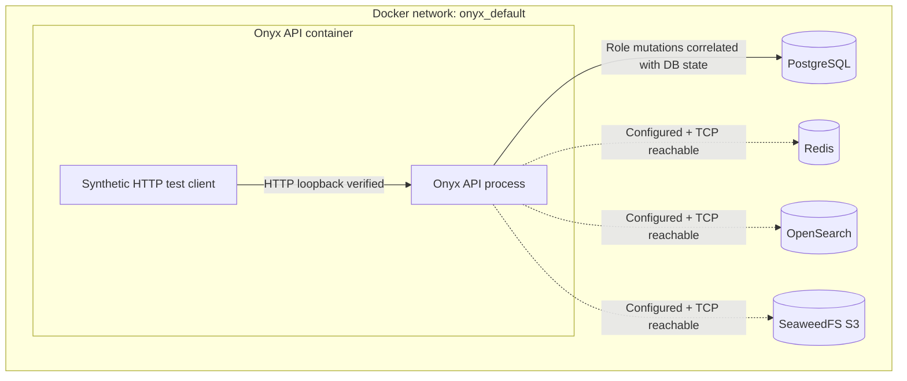

# WP-6.1.2 — Onyx Reference Architecture and Data-Flow Assessment

## 1. Scope and provenance

- Application: Onyx v5.1.3
- Environment: isolated GitHub Codespaces Docker laboratory
- Assessment type: architecture and data-flow discovery
- Runtime source: `3835aa4294198de48d318536081ea09fbde7aea6`
- Report generated UTC: 2026-11-20T20:43:21.596379+00:00
- Separate reference: P-006 Secure-by-Default LLM Application Reference Architecture

This workpaper describes observed and declared architecture.
It is not a production security certification.

## 2. Component inventory

- Declared services: 14
- Running services: 5
- Declared but not running: 9

| Service | Runtime state | Health | Host ports |
|---|---|---|---|
| `api_server` | running | healthy | None published |
| `cache` | running | not_configured | None published |
| `object-store` | running | healthy | None published |
| `opensearch` | running | not_configured | None published |
| `relational_db` | running | healthy | None published |

### Declared services not running

`background`, `code-interpreter`, `indexing_model_server`, `inference_model_server`, `mcp_server`, `minio`, `nginx`, `object-store-copy`, `web_server`

Their absence limits the assessment scope.
It is not, by itself, evidence of a vulnerability.

## 3. Observed deployment architecture

Diagram conventions:
- Solid: application behavior supported by prior 6.1.1 tests.
- Dashed: configured destination and TCP reachability only.
- No browser, frontend, inference or background path is claimed as tested.

## 4. Dependency and data-flow register

| ID | Flow | Evidence | Assessment status |
|---|---|---|---|
| DF-01 | In-container synthetic test client -> API | 6.1.1 live HTTP tests | Verified for tested requests |
| DF-02 | API -> PostgreSQL role changes | HTTP mutation and independent persisted-state checks | Behavior corroborated |
| DF-03 | API -> PostgreSQL (`relational_db:5432`) | TCP reachable; role mutations and persisted state corroborated by 6.1.1 tests | Selected role operations verified; broader database flows untested |
| DF-04 | API -> Redis (`cache:6379`) | Synthetic login, Redis session key and logout behavior observed | Tested session lifecycle verified; broader Redis operations untested |
| DF-05 | API-container test client -> OpenSearch (`opensearch:9200`) | Direct authenticated metadata requests succeeded | Client-to-service boundary verified; Onyx search and indexing not tested |
| DF-06 | API-container test client -> SeaweedFS S3 (`object-store:8333`) | Authenticated synthetic object create/read/delete, SHA-256 integrity and deletion verified; unsigned GET returned 403 | Direct S3 lifecycle verified; Onyx file API and tenant isolation untested |
| DF-07 | Browser -> frontend/reverse proxy -> API | Frontend and nginx not running | Not tested |
| DF-08 | Background workers -> dependencies | Background service not running | Not tested |
| DF-09 | API -> inference model server | Model server disabled and not running | Not tested |
| DF-10 | MCP service -> application | MCP service not running | Not tested |

## 5. Security trust-boundary register

| Boundary | Security question | Current evidence |
|---|---|---|
| Test operator -> API container | Who controls execution and credentials? | Trusted local operator; separate hardening review required |
| Human session -> API authorization | Are privileged actions authorized? | Selected 6.1.1 controls passed |
| API -> PostgreSQL | Are database credentials least-privileged? | Database connectivity confirmed; role privileges not audited |
| API -> Redis | Is access authenticated and restricted? | TCP reachable; authentication not verified |
| API -> OpenSearch | Are searches and indices access-controlled? | TCP reachable; authorization not verified |
| API -> S3 storage | Are bucket/object operations authorized? | S3 destination configured; object-level tests pending |
| Docker network -> host | Is unintended exposure prevented? | No Docker host port bindings observed |
| Container -> storage mount | Are stored data and secrets protected? | Mount metadata recorded; storage controls not assessed |

## 6. Observed API configuration

| Configuration key | Observed value |
|---|---|
| `AUTH_TYPE` | `basic` |
| `DISABLE_MODEL_SERVER` | `true` |
| `FILE_STORE_BACKEND` | `s3` |
| `POSTGRES_HOST` | `relational_db` |
| `POSTGRES_PORT` | `NOT_SET` |
| `REDIS_HOST` | `cache` |
| `OPENSEARCH_HOST` | `opensearch` |
| `MODEL_SERVER_HOST` | `inference_model_server` |
| `INDEXING_MODEL_SERVER_HOST` | `indexing_model_server` |

- S3 destination: `http://object-store:8333`

## 7. Mount inventory

| Running service | Mount count |
|---|---:|
| `api_server` | 2 |
| `cache` | 0 |
| `object-store` | 1 |
| `opensearch` | 1 |
| `relational_db` | 1 |

Mount counts do not establish encryption, backup,
file permissions or data-retention controls.

## 8. P-006 comparison

P-006 is a separate, synthetic reference architecture.
It uses Open WebUI, Keycloak, a Python PEP, OPA, Vault,
LiteLLM and a deterministic backend.

These products must not be assumed to exist in Onyx.
Compare design properties such as identity propagation,
policy enforcement, workload credentials and gateway boundaries
rather than treating product-name differences as vulnerabilities.

## 9. Outstanding verification tasks

- [ ] Trace a real authenticated API request through application code.
- [ ] Verify broader Redis operations and credential/ACL security (synthetic session lifecycle verified in Section 12).
- [ ] Verify Onyx application-level search/index operations and OpenSearch access controls (direct authenticated metadata access verified in Section 13).
- [ ] Verify Onyx file API operations and object-level authorization (direct synthetic S3 lifecycle completed in Section 15).
- [ ] Review service credentials and least privilege.
- [ ] Review internal transport protection and network segmentation.
- [ ] Trace frontend and browser traffic in a separately provisioned lab.
- [ ] Assess background, connector, MCP and inference data flows.
- [ ] Independently explain and defend the trust-boundary model.

## 10. Evidence integrity

| File | SHA-256 |
|---|---|
| `onyx-runtime-inventory.json` | `805f8afe9df238551b959e9b065d2ed1ac9f569ab43ed353ae5702b28d570b25` |
| `onyx-network-reachability.json` | `fdb31fc94bc42ea403228883a996802ecb40b7fea88268a59f2b65226364bc51` |
| `onyx-component-dependencies.json` | `048bdfcecea4f08914b0c9c5cf386f61f2e256f6a898b47ca1731d9cd057b621` |

## 11. Assessment disposition

**Status: INITIAL ARCHITECTURE RECONSTRUCTION COMPLETE.**

The component inventory and network observations are recorded.
Application-level data flows beyond the previously tested
authorization/database behavior remain partially or wholly unverified.
No architectural vulnerability is claimed from this inventory alone.

## Source references

- Onyx v5.1.3: https://github.com/onyx-dot-app/onyx/blob/v5.1.3/deployment/docker_compose/docker-compose.yml
- P-006: https://github.com/amaw595959-lang/project001/blob/2388de2/p-006/docs/architecture.md
- 6.1.1 runtime evidence: ../6.1.1/ONYX-611-Runtime-Authorization-Evidence.md
- 6.1.1 database regression: ../6.1.1/evidence/ONYX-611-Authz-DB-Regression.json

## 12. Subsequent Redis Session Data-Flow Verification

**Date:** 2026-11-20

**Flow:** Onyx API -> Redis authentication-session storage.

**Execution:** Live API and Redis tests within the isolated
Onyx v5.1.3 Docker laboratory.

### Verified observations

- Redis connection succeeded.
- Synthetic member login returned HTTP 204.
- A corresponding Redis session key existed.
- The session key had a positive TTL.
- The original authentication token accessed `/me` successfully.
- Logout returned HTTP 204.
- Reusing the original token after logout returned HTTP 403.

**Result:** PASS — 7 of 7 checks.

### Security interpretation

The observed application behavior corroborates Redis-backed
session storage and logout invalidation for the tested account.

This does not establish production session security, complete
session revocation coverage, or Redis access-control strength.

The test did not independently inspect the post-logout Redis
tombstone value.

### Evidence integrity

- Test script SHA-256: `ca21859f8a23326f4abb534f84d84ccc48849ee9bef207b768852741ede4c9ba`
- JSON evidence SHA-256: `6322861da656b515e895ff557d3858618fe1dea6e6e58421816d8482d16bd026`

### Evidence references

- `tests/redis_session_flow.py`
- `evidence/onyx-redis-session-flow.json`

## 13. Authenticated OpenSearch Boundary Verification

**Evidence timestamp:** 2026-11-20T20:52:08.098104+00:00

**Source:** Test script executed within the Onyx API container.

**Destination:** `opensearch:9200`

### Observations

- OpenSearch version: `3.6.0`
- Cluster health: `yellow`
- Cluster nodes: 1
- Visible open indices: 5
- TLS enabled: True
- Server certificate verification: False
- Authentication method: `basic`
- Read-only metadata requests: 3/3 successful

### Security interpretation

Direct authenticated OpenSearch access from the API container was verified.

TLS is enabled, but server certificate verification was disabled in
the tested client configuration. Server-identity assurance requires
further assessment.

The yellow cluster status indicates incomplete replica allocation.
The specific allocation cause was not independently diagnosed.

The test used credentials supplied to the API container and queried
OpenSearch directly. It did not demonstrate an Onyx application
search or indexing operation.

No unauthorized access, certificate-interception attack, search-data
disclosure, or exploitable vulnerability was demonstrated.

### Remaining work

- Trace a real Onyx search or indexing request to OpenSearch.
- Review OpenSearch credential privileges and least-privilege options.
- Assess server certificate validation and internal transport trust.
- Verify index and document access boundaries using synthetic fixtures.
- Investigate the cluster's unassigned replicas if operationally relevant.

### Evidence references and SHA-256

- `tests/opensearch_boundary.py`: `1db562cf7bf7ea01725b25bf66db351538c1c111415415cee536476ae05a511a`
- `evidence/onyx-opensearch-boundary.json`: `8a44f7c777d8b50a7b6bfb213ac91cc4570c4bf5f88e434527ffef9c2688337e`

## 14. Read-only S3 Authentication Boundary Verification

**Evidence timestamp:** 2026-11-20T20:56:02.119642+00:00

**Source:** Synthetic test client running inside the Onyx API container.

**Destination:** `object-store:8333`

### Verified observations

- Authenticated bucket metadata request: PASS
- Authenticated read-only object listing: PASS
- Unsigned bucket metadata request: HTTP 403
- Transport: HTTP over the internal Docker network
- Overall: PASS

### Security interpretation

The configured storage credentials were accepted by SeaweedFS S3.
An unsigned request for the tested bucket metadata was denied.

The S3 endpoint uses plaintext HTTP at the application-transport layer.
The network trust model and credential privileges require further review.

This test used a direct S3 client, not an Onyx application file API.
No object contents were read, created, modified or deleted.

No unauthorized object access or cross-tenant access was demonstrated.

### Outstanding assessment tasks

- [x] Verify synthetic object create, read and delete operations (Section 15).
- [x] Verify cleanup through authenticated post-deletion HEAD (Section 15).
- Assess workload-credential privileges and least privilege.
- Assess object-level and cross-tenant authorization.
- Trace actual Onyx file-store operations.
- Assess transport security in the intended deployment.

### Evidence integrity

- Script SHA-256: `bd6b1ed19c2996d54ee78e857833f192227bddcc67fe3dff862084647efe3011`
- JSON SHA-256: `3d746358bc536a50a7e483f280d8e2da9e59b33630fa1750d3151522d4ce4aa0`

### Evidence references

- `tests/s3_boundary.py`
- `evidence/onyx-s3-boundary.json`

## 15. Controlled S3 Object Lifecycle Verification

**Evidence timestamp:** 2026-11-20T21:01:04.075308+00:00

**Source:** Synthetic S3 test client executed inside the Onyx API container.

**Destination:** `object-store:8333`

### Verified observations

- Authenticated bucket access: PASS
- Synthetic object initially absent: PASS
- Synthetic object created: PASS
- Synthetic object retrieved: PASS
- Retrieved content SHA-256 matched expected content: PASS
- Unsigned GET denied: HTTP 403
- Synthetic object delete request succeeded: PASS
- Authenticated HEAD confirmed object absence after deletion: PASS
- Private recovery record absent after successful cleanup: verified separately
- Overall: PASS, 8/8 checks

### Security interpretation

A direct authenticated S3 client successfully completed one synthetic
object create/read/delete lifecycle. The retrieved content matched
its expected digest. An unsigned GET was denied with HTTP 403.

The final authenticated HEAD returned HTTP 404, consistent with
the test object being absent after deletion.

The test did not exercise an Onyx file API handler and did not establish
cross-user isolation, cross-tenant isolation or least-privilege credentials.

The storage endpoint used HTTP inside the Docker network; its
transport-security implications remain subject to threat modeling.

### Failed preflight and correction

An earlier attempt stopped with FileNotFoundError while attempting
to create a private recovery record under `/workspaces` inside the
API container. The synthetic object upload had not started.

The script was corrected to use a writable mounted directory under
`/var/log/onyx`, and the complete lifecycle subsequently passed.

The failed preflight is retained as diagnostic evidence. Its cleanup
status must not be interpreted as proof that an object remained stored.

### Outstanding verification

- Trace an actual Onyx file-store API operation.
- Assess user and tenant authorization independently of S3 administrator access.
- Review the privileges associated with the S3 workload credentials.
- Assess network isolation and plaintext HTTP transport assumptions.
- Repeat selected checks under appropriately restricted credentials.

### Evidence SHA-256

- Test script: `5c261257b31cb70f3333e4192c5df1adb389b65e9c93837708be5cd34ef30f17`
- Successful JSON: `09f3c48fdb920ec01211b67d85e07b80f6b8a9d3f128a481dee1f26feed28c98`
- Failed preflight JSON: `eb0965897b5dcfbc609119d5a6a138d07636f27801b1eb34bee74673b362d2d3`

### Evidence references

- `tests/s3_object_lifecycle.py`
- `evidence/onyx-s3-object-lifecycle.json`
- `evidence/onyx-s3-object-lifecycle-preflight-failed.json`

## 16. Onyx File-Store Source and Trust-Boundary Trace

**Source commit:** `3835aa4294198de48d318536081ea09fbde7aea6`

**Assessment method:** Read-only Python AST analysis of the Onyx v5.1.3 source checkout.

### Verified source relationships

| Function | Source lines | Call relationships |
|---|---|---|
| `_build_default_file_store` | `backend/onyx/file_store/file_store.py:904-945` | `FileStoreType`, `PostgresBackedFileStore`, `get_azure_file_store`, `get_gcs_file_store`, `get_s3_file_store` |
| `get_s3_file_store` | `backend/onyx/file_store/file_store.py:811-834` | `RuntimeError`, `S3BackedFileStore` |
| `S3BackedFileStore._get_s3_key` | `backend/onyx/file_store/file_store.py:523-538` | `generate_s3_key`, `get_current_tenant_id`, `info`, `len` |
| `S3BackedFileStore.save_file` | `backend/onyx/file_store/file_store.py:561-626` | `_get_bucket_name`, `_get_s3_client`, `_get_s3_key`, `_put_legacy_object`, `commit`, `content_byte_size`, `encode`, `get_session_with_current_tenant_if_none`, `hasattr`, `hexdigest`, `isinstance`, `put_object`, `read`, `seek`, `sha256`, `str`, `update`, `upsert_filerecord`, `uuid4` |
| `S3BackedFileStore.read_file` | `backend/onyx/file_store/file_store.py:628-664` | `BytesIO`, `NamedTemporaryFile`, `_with_legacy_fallback`, `error`, `get_filerecord_by_file_id`, `get_object`, `get_session_with_current_tenant_if_none`, `iter_chunks`, `read`, `seek`, `write` |
| `S3BackedFileStore.delete_file` | `backend/onyx/file_store/file_store.py:704-758` | `RuntimeError`, `_delete_legacy_object`, `_get_s3_client`, `commit`, `delete_filerecord_by_file_id`, `delete_object`, `error`, `get_filerecord_by_file_id_for_update`, `get_session_with_current_tenant_if_none`, `is_missing_object`, `rollback`, `warning` |
| `generate_s3_key` | `backend/onyx/file_store/s3_key_utils.py:119-166` | `encode`, `hexdigest`, `join`, `len`, `max`, `sanitize_s3_key_name`, `sha256`, `strip` |
| `get_filerecord_by_file_id` | `backend/onyx/db/file_record.py:52-63` | `FileRecordNotFoundError`, `filter_by`, `first`, `query` |
| `get_current_tenant_id` | `backend/shared_configs/contextvars.py:72-86` | `RuntimeError`, `format_stack`, `get`, `join` |

### Security interpretation

- The configured file-store factory selects an S3-backed implementation.
- S3 object-key construction uses the current tenant context.
- File saving includes S3 object creation and PostgreSQL file metadata.
- File reads resolve the stored object location through a database record.
- File deletion includes database-record and S3-object operations.

Tenant-prefixed object keys are a namespace mechanism, not proof
of user-level ownership authorization.

The file-store methods do not independently establish that
an external requester is authorized to access a particular file.
Authorization must also be examined at the calling application layer.

### Example application handler for further assessment

`backend/onyx/server/features/persona/api.py` contains
`get_persona_avatar`, which depends on `BASIC_ACCESS`,
retrieves a persona using the requesting user context,
checks the file record and origin, and calls `read_file`.

These relationships were independently reviewed in source;
the handler has not yet been tested as an end-to-end storage flow.

### Outstanding work

- Trace authorization and persona visibility into the avatar handler.
- Test permitted and denied requests using synthetic users and assets.
- Verify whether the Onyx handler actually retrieves the S3 object.
- Assess tenant-context propagation and object-key isolation.
- Assess file ownership checks independently of storage credentials.
- Investigate failure consistency between S3 and database metadata.

### Evidence integrity

- Script SHA-256: `6d488732cde38b86ea06367651c0443c12afbaadcfcec9a2f8cc5b76faa56dcb`
- JSON SHA-256: `f9417011d8cb6fd6df4dcd2661ae2fb556b2df29f95f41741e349480534005b9`

### Evidence references

- `tests/filestore_source_trace.py`
- `evidence/onyx-filestore-source-trace.json`

### Source references

- https://github.com/onyx-dot-app/onyx/blob/v5.1.3/backend/onyx/file_store/file_store.py
- https://github.com/onyx-dot-app/onyx/blob/v5.1.3/backend/onyx/file_store/s3_key_utils.py
- https://github.com/onyx-dot-app/onyx/blob/v5.1.3/backend/onyx/server/features/persona/api.py

## 17. Persona-Avatar Authorization Source Trace

**Evidence timestamp:** 2026-11-20T21:09:55.466108+00:00
**Source commit:** `3835aa4294198de48d318536081ea09fbde7aea6`
**Route:** `/persona/{persona_id}/avatar`

### Source verification results

| Check | Result |
|---|---|
| `avatar_route_declared` | PASS |
| `persona_router_prefix` | PASS |
| `persona_router_registered` | PASS |
| `basic_access_permission` | PASS |
| `requesting_user_passed_to_persona_lookup` | PASS |
| `persona_read_mode` | PASS |
| `persona_checked_before_file_read` | PASS |
| `file_origin_checked` | PASS |
| `missing_avatar_returns_not_found` | PASS |
| `global_permission_paths_present` | PASS |
| `ownership_and_sharing_paths_present` | PASS |

**Result:** PASS — 11/11 static source checks.

### Observed source relationships

1. Persona-avatar route registered.
2. BASIC_ACCESS permission dependency declared.
3. Requesting user passed to persona lookup.
4. Persona visibility logic includes ownership, sharing and privileged access.
5. File record examined after persona lookup.
6. File origin checked before storage read.
7. FileStore read called after preceding checks.

### Security interpretation

The source contains authorization-related checks before the
avatar file-store read. Their runtime enforcement and completeness
have not yet been independently demonstrated.

The trace does not prove cross-user isolation, cross-tenant
isolation, or successful retrieval of an authorized avatar.

### Test methodology correction

An earlier static check failed because AST source-segment
extraction excluded the route decorator. The check was
corrected to inspect the function's AST decorator_list.
The corrected 11-check assessment passed.

### Next verification tasks

- [x] Confirm unauthenticated requests to the sentinel avatar route are denied (Section 18; HTTP 403).
- [ ] Test authorized access to a synthetic avatar.
- [ ] Test cross-user denial using a private synthetic persona.
- [ ] Verify intentional sharing behavior.
- [ ] Correlate an authorized avatar request with storage access.
- [ ] Confirm relevant controls after role or sharing changes.

### Evidence integrity

- Script SHA-256: `03353995adac5a379eba4d9d8188ac1a8837bdd4910d78acb8d14800aad43e40`
- JSON SHA-256: `e3d0db10561a9c4b38c2d9311ad3ac40210acc6d871300024d000f6eb0a18160`

### Evidence references

- `tests/persona_avatar_authorization_trace.py`
- `evidence/onyx-persona-avatar-authorization-trace.json`

### Source references

- https://github.com/onyx-dot-app/onyx/blob/v5.1.3/backend/onyx/server/features/persona/api.py
- https://github.com/onyx-dot-app/onyx/blob/v5.1.3/backend/onyx/db/persona.py

## 18. Live Persona-Avatar HTTP Negative-Path Verification

**Evidence timestamp:** 2026-11-20T21:13:36.644254+00:00

**Target:** Onyx v5.1.3, isolated Docker laboratory.

**Method:** Live HTTP requests using synthetic admin and member accounts.

### Observed results

| Check | HTTP status |
|---|---:|
| Anonymous avatar request | 403 |
| Member login | 204 |
| Member `/me` | 200 |
| Member nonexistent avatar | 404 |
| Member logout | 204 |
| Member `/me` after logout | 403 |
| Admin login | 204 |
| Admin `/me` | 200 |
| Admin nonexistent avatar | 404 |
| Admin logout | 204 |
| Admin `/me` after logout | 403 |

**Result:** PASS — 11/11 live HTTP checks.

### Security interpretation

The unauthenticated avatar request was denied.
Both synthetic accounts received 404 for the nonexistent
persona ID -1. Both test sessions were invalidated after logout.

These results corroborate authentication enforcement and
negative-path behavior for the tested endpoint.

They do not establish object ownership enforcement,
cross-user isolation, cross-tenant isolation,
successful avatar retrieval, or S3 access by the handler.

### Outstanding verification

- Test authorized retrieval using a synthetic private persona.
- Test access denial for another ordinary user.
- Verify explicitly granted sharing.
- Correlate a successful avatar HTTP request with S3 access.
- Assess access after sharing or role changes.

### Evidence integrity

- Test script SHA-256: `47c0393904f6f176be08249920488d18f4b87bcb13c10d0dbc0c7764d962c64e`
- JSON evidence SHA-256: `2c16715a6477a3b9a94b2f0084508a7c849dd0c577cb257580eb75d1c319d136`

### Evidence references

- `tests/persona_avatar_http_preflight.py`
- `evidence/onyx-persona-avatar-http-preflight.json`
