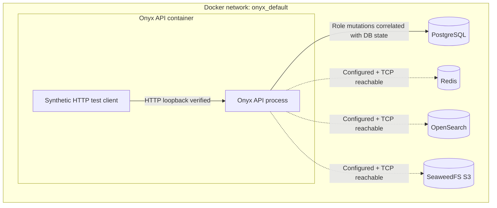

# WP-6.1.2 — Onyx Reference Architecture and Data-Flow Assessment

## 1. Scope and provenance

- Application: Onyx v5.1.3
- Environment: isolated GitHub Codespaces Docker laboratory
- Assessment type: architecture and data-flow discovery
- Runtime source: `3835aa4294198de48d318536081ea09fbde7aea6`
- Report generated UTC: 2026-11-20T20:43:21.596379+00:00
- Separate reference: P-006 Secure-by-Default LLM Application Reference Architecture

This workpaper describes observed and declared architecture.
It is not a production security certification.

## 2. Component inventory

- Declared services: 14
- Running services: 5
- Declared but not running: 9

| Service | Runtime state | Health | Host ports |
|---|---|---|---|
| `api_server` | running | healthy | None published |
| `cache` | running | not_configured | None published |
| `object-store` | running | healthy | None published |
| `opensearch` | running | not_configured | None published |
| `relational_db` | running | healthy | None published |

### Declared services not running

`background`, `code-interpreter`, `indexing_model_server`, `inference_model_server`, `mcp_server`, `minio`, `nginx`, `object-store-copy`, `web_server`

Their absence limits the assessment scope.
It is not, by itself, evidence of a vulnerability.

## 3. Observed deployment architecture

Diagram conventions:
- Solid: application behavior supported by prior 6.1.1 tests.
- Dashed: configured destination and TCP reachability only.
- No browser, frontend, inference or background path is claimed as tested.

## 4. Dependency and data-flow register

| ID | Flow | Evidence | Assessment status |
|---|---|---|---|
| DF-01 | In-container synthetic test client -> API | 6.1.1 live HTTP tests | Verified for tested requests |
| DF-02 | API -> PostgreSQL role changes | HTTP mutation and independent persisted-state checks | Behavior corroborated |
| DF-03 | API -> PostgreSQL (`relational_db:5432`) | REACHABLE TCP; configured destination | Application data operations not verified |
| DF-04 | API -> Redis (`cache:6379`) | REACHABLE TCP; configured destination | Application data operations not verified |
| DF-05 | API -> OpenSearch (`opensearch:9200`) | REACHABLE TCP; configured destination | Application data operations not verified |
| DF-06 | API -> SeaweedFS S3 (`object-store:8333`) | REACHABLE TCP; configured destination | Application data operations not verified |
| DF-07 | Browser -> frontend/reverse proxy -> API | Frontend and nginx not running | Not tested |
| DF-08 | Background workers -> dependencies | Background service not running | Not tested |
| DF-09 | API -> inference model server | Model server disabled and not running | Not tested |
| DF-10 | MCP service -> application | MCP service not running | Not tested |

## 5. Security trust-boundary register

| Boundary | Security question | Current evidence |
|---|---|---|
| Test operator -> API container | Who controls execution and credentials? | Trusted local operator; separate hardening review required |
| Human session -> API authorization | Are privileged actions authorized? | Selected 6.1.1 controls passed |
| API -> PostgreSQL | Are database credentials least-privileged? | Database connectivity confirmed; role privileges not audited |
| API -> Redis | Is access authenticated and restricted? | TCP reachable; authentication not verified |
| API -> OpenSearch | Are searches and indices access-controlled? | TCP reachable; authorization not verified |
| API -> S3 storage | Are bucket/object operations authorized? | S3 destination configured; object-level tests pending |
| Docker network -> host | Is unintended exposure prevented? | No Docker host port bindings observed |
| Container -> storage mount | Are stored data and secrets protected? | Mount metadata recorded; storage controls not assessed |

## 6. Observed API configuration

| Configuration key | Observed value |
|---|---|
| `AUTH_TYPE` | `basic` |
| `DISABLE_MODEL_SERVER` | `true` |
| `FILE_STORE_BACKEND` | `s3` |
| `POSTGRES_HOST` | `relational_db` |
| `POSTGRES_PORT` | `NOT_SET` |
| `REDIS_HOST` | `cache` |
| `OPENSEARCH_HOST` | `opensearch` |
| `MODEL_SERVER_HOST` | `inference_model_server` |
| `INDEXING_MODEL_SERVER_HOST` | `indexing_model_server` |

- S3 destination: `http://object-store:8333`

## 7. Mount inventory

| Running service | Mount count |
|---|---:|
| `api_server` | 2 |
| `cache` | 0 |
| `object-store` | 1 |
| `opensearch` | 1 |
| `relational_db` | 1 |

Mount counts do not establish encryption, backup,
file permissions or data-retention controls.

## 8. P-006 comparison

P-006 is a separate, synthetic reference architecture.
It uses Open WebUI, Keycloak, a Python PEP, OPA, Vault,
LiteLLM and a deterministic backend.

These products must not be assumed to exist in Onyx.
Compare design properties such as identity propagation,
policy enforcement, workload credentials and gateway boundaries
rather than treating product-name differences as vulnerabilities.

## 9. Outstanding verification tasks

- [ ] Trace a real authenticated API request through application code.
- [ ] Confirm actual Redis operations and associated credentials.
- [ ] Confirm actual OpenSearch queries and access controls.
- [ ] Confirm authorized and unauthorized S3 object operations.
- [ ] Review service credentials and least privilege.
- [ ] Review internal transport protection and network segmentation.
- [ ] Trace frontend and browser traffic in a separately provisioned lab.
- [ ] Assess background, connector, MCP and inference data flows.
- [ ] Independently explain and defend the trust-boundary model.

## 10. Evidence integrity

| File | SHA-256 |
|---|---|
| `onyx-runtime-inventory.json` | `805f8afe9df238551b959e9b065d2ed1ac9f569ab43ed353ae5702b28d570b25` |
| `onyx-network-reachability.json` | `fdb31fc94bc42ea403228883a996802ecb40b7fea88268a59f2b65226364bc51` |
| `onyx-component-dependencies.json` | `048bdfcecea4f08914b0c9c5cf386f61f2e256f6a898b47ca1731d9cd057b621` |

## 11. Assessment disposition

**Status: INITIAL ARCHITECTURE RECONSTRUCTION COMPLETE.**

The component inventory and network observations are recorded.
Application-level data flows beyond the previously tested
authorization/database behavior remain partially or wholly unverified.
No architectural vulnerability is claimed from this inventory alone.

## Source references

- Onyx v5.1.3: https://github.com/onyx-dot-app/onyx/blob/v5.1.3/deployment/docker_compose/docker-compose.yml
- P-006: https://github.com/amaw595959-lang/project001/blob/2388de2/p-006/docs/architecture.md
- 6.1.1 runtime evidence: ../6.1.1/ONYX-611-Runtime-Authorization-Evidence.md
- 6.1.1 database regression: ../6.1.1/evidence/ONYX-611-Authz-DB-Regression.json
