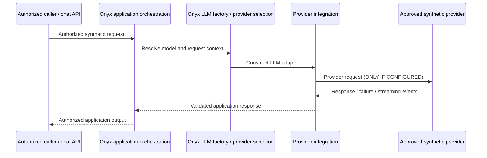

# WP-6.1.3 — LLM API Integration, Orchestration and Secure Defaults

**Curriculum ID:** 6.1.3 (Layer 6 > 6.1)  
**Canonical P-project:** P-006, Secure-by-Default LLM Application Reference Architecture  
**Unfamiliar application:** Onyx v5.1.3 at upstream commit `3835aa4294198de48d318536081ea09fbde7aea6`  
**Reference repository:** https://github.com/amaw595959-lang/project001  
**Reviewed repository ref:** `assessment/onyx-611-verification`, commit `8462d9cb05bcaa81b5a503cbf7d260e6992f27d2`  
**Prepared:** 2026-11-21. This document is a **planning and source-review artifact**, not a record of new execution.

## A. Scope and current evidence

**Objective:** Independently identify, explain, verify, compare and (where applicable) remediate how a user request becomes a permitted LLM API call; where the model, tenant, budget, credential, transport, timeout, streaming, routing and output guarantees are enforced.

**Owned-lab scope:** P-006 synthetic local profile; separately isolated Onyx v5.1.3 test instance with synthetic accounts; no external provider account, real AWS, internet scanning, real secrets or real user data. Only enable optional tests after validating user-owned lab authorization and resource availability. Do not deploy a real hosted provider, expose a public port, or attach a paid key as part of this work package.

### Previously recorded, NOT independently rerun here

* `p-006/docs/validation-status.md` (2026-11-16) records historical P-006 integration exercises with real local Open WebUI, Keycloak, OPA, Vault, LiteLLM and a **deterministic backend**, including denials, segmentation, local gateway checks and failure handling. This is **historical test evidence**, not current environment confirmation.
* `assessments/onyx/6.1.2/WP-6.1.2-Onyx-Architecture-Assessment-2026-11-20.md` records Onyx v5.1.3 with five running services (`api_server`, PostgreSQL, Redis, OpenSearch, object-store), nine declared services not running and `DISABLE_MODEL_SERVER=true`; **no model invocation test was performed**. This configuration flag does not itself prove that Onyx cannot use a separate hosted or configured LLM provider.
* P-006's deterministic backend tests **cannot establish** generative-model behavior or prompt-injection resistance.
* Do not translate P-006's names/assumptions into Onyx as facts. Onyx has its own LLM adapter and provider-selection architecture.

### Pinpointed source entry points

| System | Source reference | What to trace |
|---|---|---|
| P-006 | `p-006/src/p006/pep.py` | `Engine.chat`, request schema, authorization, quota, backend completion, response projection |
| P-006 | `p-006/src/p006/adapters.py` | `Gateway.complete`, Vault credential retrieval, canonical HMAC signing |
| P-006 | `p-006/src/p006/gateway_auth.py` | LiteLLM proof check, request shape, freshness/nonce and replay rejection |
| P-006 | `p-006/gateway/litellm/config.yaml` | Fixed local routes, no retry, logging/cache controls |
| P-006 | `p-006/src/p006/transport.py` | HTTP timeouts, redirected calls, bounded response bodies and exception mapping |
| P-006 | `p-006/src/p006/entrypoint.py` | Deterministic model backend and local credential check |
| P-006 | `p-006/config/hardened.json` | Model allowlist, profile limits, networks, fixed routing |
| Onyx v5.1.3 | `backend/onyx/llm/factory.py` | Provider/model selection, overrides, fallback and provider authorization checks |
| Onyx v5.1.3 | `backend/onyx/llm/model_request.py` | Building and serializing provider request messages |
| Onyx v5.1.3 | `backend/onyx/llm/interfaces.py` | `GenerationContext`, timeouts and streaming contracts |
| Onyx v5.1.3 | `backend/onyx/llm/multi_llm.py` | Actual provider invocation/stream implementation |
| Onyx v5.1.3 | `backend/onyx/llm/api_surfaces.py` | Provider endpoint surface selection |
| Onyx v5.1.3 | `backend/onyx/llm/README.md` | Streaming event/tool-call handling; incomplete streamed tool arguments must not be executed |

**Primary proof rule:** `SOURCE_CONFIRMED` is not `RUNTIME_CONFIRMED`; historical `PASS` is not a new `PASS`.

## B. 22 atomic engineering tasks (perform in dependency order)

| ID | Task | Required receipt |
|---|---|---|
| 613-01 | Declare exact source commits, authorized scope, exclusions and stop criteria | Git SHA, test scope, date/environment |
| 613-02 | Inspect existing 6.1.1/6.1.2 architecture and preserve results | Previous workpaper reference and delta register |
| 613-03 | Identify P-006's human/API caller, PEP, policy, secrets, gateway and model principals | Source-linked identities/flow map |
| 613-04 | Reconstruct P-006's actual chat request flow from API boundary to backend and return | Source/function sequence diagram |
| 613-05 | Determine P-006 model allowlist, role rules and maximum output token policy | Code/config lines and invariant |
| 613-06 | Determine P-006 handling of metadata, tool arguments, external URLs and streaming flags | Accepted/denied parameter table |
| 613-07 | Verify authentication and per-request authorization precede dispatch | Authorized, unauthorized and bypass test IDs |
| 613-08 | Trace app-to-gateway workload credentials and proof binding, without showing secrets | HMAC/key/nonce/expiry lifecycle map |
| 613-09 | Verify LiteLLM fixed routing to local deterministic model; no user-controlled provider | Config audit and native test where available |
| 613-10 | Verify upstream credential is not returned in downstream responses | Marker test and sanitized receipt |
| 613-11 | Assess request length, token cap, rate/tenant budget and in-flight bound | Config + observed 400/413/429 where reproducible |
| 613-12 | Assess client timeout, total deadline, retry/failover, redirects and response size | Source path + controlled outage test |
| 613-13 | Assess model output projection, error redaction and safe logging | Response/error checks; no raw payload archive |
| 613-14 | Assess normal and streaming response shapes and tool-call handling | Normal/SSE test or NOT_APPLICABLE reason |
| 613-15 | Verify Docker network/egress paths between app, gateway, model | Actual owned-container reachability evidence |
| 613-16 | Determine what is demonstrably synthetic versus real native-product behavior | Explicit limitations register |
| 613-17 | Read Onyx v5.1.3 model/provider resolution, overrides and access-control code | Exact source references and request-path hypothesis |
| 613-18 | Read Onyx provider request creation, API-surface choice, streaming, timeout and errors | Independent source-linked diagram |
| 613-19 | Inspect **local Onyx deployment** for configured provider availability without printing secrets | Redacted provider/endpoint inventory; model call remains NOT_TESTED until executed |
| 613-20 | If a local mock provider is approved and safely reachable, test one synthetic Onyx model request; otherwise mark BLOCKED | Sanitized HTTP/trace result or blocker |
| 613-21 | Compare invariants (not component names) across P-006 and Onyx; formulate applicable gaps | Evidence-backed comparison matrix |
| 613-22 | Retest any changed control, preserve receipts, explain independently and hand off to 6.1.4 | Gate verdicts, follow-up, learner explanation |

### Independent predictions to write *before* execution

* A caller cannot select a model/tenant or provider beyond its server-side authorization.
* An unauthorized or malformed request cannot reach a privileged backend operation.
* No caller-supplied `api_base` can escape the P-006 local model route.
* Missing Keycloak/OPA/Vault/gateway must deny safely; no silent public/weak fallback.
* Secrets, raw provider errors and user prompt strings must not enter routine evidence logs.
* Onyx outcomes are **unknown** until its own code paths/configuration and runtime are tested.

## C. Ready-to-use shell commands (run in your authorized checkout; do not publish secrets)

### C1. Preflight: read-only and no assumption about current checkout path

```bash
# Run from the existing project001 checkout. Avoid hardcoded Codespaces paths.
pwd
git remote -v
git status --short
git branch --show-current
git rev-parse HEAD
printf 'P006 source entry points:\n'
git ls-files 'p-006/src/p006/*.py' 'p-006/gateway/litellm/*' 'p-006/tests/*'
# Onyx checkout is deliberately not guessed. Identify it manually.
```

If the active branch or SHA differs from the reviewed commit, record the delta and inspect before executing.

### C2. Inspect controls without reading secrets

```bash
rg -n 'async def chat|async def authorize|async def complete|def seal|class Limits|class Gateway|def create_app|async def request' \
  p-006/src/p006/pep.py p-006/src/p006/adapters.py p-006/src/p006/transport.py
rg -n 'custom_auth|model_name|api_base|request_timeout|num_retries|cache|turn_off_message_logging' \
  p-006/gateway/litellm/config.yaml
rg -n 'requests_per_minute|tenant_tokens_per_minute|max_request_bytes|"models"|"route"' \
  p-006/config/hardened.json
sha256sum p-006/src/p006/pep.py p-006/src/p006/gateway_auth.py \
  p-006/gateway/litellm/config.yaml p-006/config/hardened.json
```

### C3. Execute existing P-006 tests (only when your environment passes preflight)

```bash
cd p-006
./scripts/setup
make doctor
make validate
make test-gateway
make test
make verify
# Verify resources are available; do not disrupt an existing shared lab.
make up
make status
make test-live
# Clean up only P006-owned resources. No docker system prune.
make down
cd ..
```

`make verify` invokes offline tests, lint/type checking and root `make unit static`; `make test-live` exercises native local integration. They **must actually run** before writing new PASS receipts. If dependencies, ports, Docker or host disk resources prevent a check, record BLOCKED and the non-sensitive reason. `make up` generates local synthetic credentials; do not inspect or paste them here.

### C4. Source-assess Onyx at the pinned revision (assuming a local checkout exists)

```bash
# Replace this with the actual existing Onyx checkout; do not assume a path.
ONYX_DIR=/path/to/your/onyx
[ -d "$ONYX_DIR/.git" ] || { echo 'BLOCKED: Onyx checkout not found'; exit 1; }
git -C "$ONYX_DIR" rev-parse HEAD
git -C "$ONYX_DIR" status --short
rg -n 'def get_llm_for_persona|_resolve_provider_and_model|can_user_access_llm_provider|check_llm_cost_limit_for_provider' \
  "$ONYX_DIR/backend/onyx/llm/factory.py"
rg -n 'GenerationContext|total_timeout_s|stall_timeout_s|def stream|def invoke' \
  "$ONYX_DIR/backend/onyx/llm/interfaces.py"
rg -n 'serialize|format_provider_message|tool_call_id' \
  "$ONYX_DIR/backend/onyx/llm/model_request.py"
rg -n 'completion|stream|timeout|retry|api_base|api_key' \
  "$ONYX_DIR/backend/onyx/llm/multi_llm.py" | head -n 80
```

If `git -C "$ONYX_DIR" rev-parse HEAD` is not the pinned upstream SHA, re-evaluate source locations and record the new version. Never print environment variables, API key columns, tokens or full request logs. Use a redacted configuration inspection before any runtime test. Do not assume `DISABLE_MODEL_SERVER=true` disables **all** external LLM providers.

## D. Test design and independent oracles

These are **proposed** tests. The HTTP statuses shown for P-006 are anchored to source and previously recorded probe expectations; they are not outputs from this session. A test passes only when a fresh run on the specified version produces and preserves the required observation.

| ID | P-006 action | Expected test oracle | Current new result |
|---|---|---|---|
| T01 | Authorized synthetic ordinary-model chat | 200; bounded synthetic completion | NOT_TESTED |
| T02 | No bearer token to PEP chat | 401; gateway not reached | NOT_TESTED |
| T03 | Ordinary user requests `local-admin` | 403; gateway not reached | NOT_TESTED |
| T04 | Unknown model | 403; no provider route | NOT_TESTED |
| T05 | Client tries `api_base` override | 400; no outbound alternate route | NOT_TESTED |
| T06 | Forged `X-User-ID`/`X-Tenant-ID` | 400 before trusting headers | NOT_TESTED |
| T07 | Oversize message | 413 at PEP | NOT_TESTED |
| T08 | Gateway direct call with no PEP proof | 403 | NOT_TESTED |
| T09 | Backend direct call without workload key | 403 | NOT_TESTED |
| T10 | Modified request body with reused HMAC | Denied, no completion | NOT_TESTED |
| T11 | Replay of same nonce/proof | Denied on second attempt | NOT_TESTED |
| T12 | Missing OPA/Vault/Keycloak/gateway | Denial or unavailable, **never weak allow** | NOT_TESTED |
| T13 | Excessive per-user calls/tenant budget | 429 once configured limit reached | NOT_TESTED |
| T14 | Malformed model result or oversized dependency response | Safe, sanitized denial | NOT_TESTED |
| T15 | Synthetic canary appears in user prompt | Canary absent from projected completion/logging receipts | NOT_TESTED |
| T16 | Network egress to non-allowlisted external target | Connection denied in owned container network | NOT_TESTED |
| T17 | Authenticated Onyx synthetic request to its own configured provider/mock | Authorized and attributable outcome under actual Onyx policy | NOT_TESTED |
| T18 | Unauthorized Onyx model/provider override | Denied by observed Onyx enforcement, if supported | NOT_TESTED |
| T19 | Onyx provider timeout/stream cancellation on approved mock | Bound, safe failure; no unauthorized action | NOT_TESTED |
| T20 | Onyx secrets/errors/cache boundaries | No unsupported leakage claim; measure only actual configured flows | NOT_TESTED |

For T17–T20, do not invent Onyx endpoint names, credentials, auth status codes or provider availability. Establish actual interface and independent test oracle first. If no local or approved mock provider exists, mark `BLOCKED` rather than modifying the production-like deployment or sending paid prompts.

## E. Receipts and redacted evidence specification

Store evidence locally under a newly created, access-restricted folder such as `assessments/onyx/6.1.3/evidence-local/` **and ensure it is ignored by Git**. Only sanitized summaries and source-linked diagrams may be considered for a later PR after review. Avoid overwriting historical 6.1.1/6.1.2 evidence. For every executed test record:

```json
{
  "schema_version": "wp-6.1.3-receipt-v1",
  "work_package": "6.1.3",
  "test_id": "T01",
  "environment": "LOCAL_SYNTHETIC_P006",
  "repo_commit": "RECORD_CURRENT_SHA",
  "source_commit": "RECORD_REFERENCE_OR_ONYX_SHA",
  "utc_timestamp": "RECORD_ACTUAL_TIME",
  "command_id": "RECORD_EXACT_COMMAND_REFERENCE",
  "expected": "HTTP 200 and synthetic bounded completion",
  "observed": "UNOBSERVED",
  "status": "NOT_TESTED",
  "oracle": "HTTP status, bounded response and no bypass from request trace",
  "raw_evidence_path": "LOCAL_REDACTED_PATH_OR_NONE",
  "raw_evidence_sha256": null,
  "limitations": ["No new execution performed"],
  "reviewed_by": "PENDING_HUMAN_REVIEW"
}
```

Safe receipt-collection example for a **pre-existing, intentionally sanitized** result file:

```bash
# Change file path only after the local P-006 run has created its results.
sha256sum p-006/docs/validation-status.md p-006/docs/litellm-gateway.md
# To record a verified command exit code without archiving secrets:
# command > /local/private/sanitized-output.txt 2>&1; rc=$?; printf '%s\n' "$rc"
```

`sha256sum` shows artifact integrity after collection. It does not establish that a source was executed by an independent evaluator or that an actual control worked.

## F. Source-linked diagrams (reuse where possible)

Existing P-006: `p-006/docs/model-flow.mmd` and `p-006/docs/failure-modes.mmd`. Amend only when new source/runtime evidence proves a discrepancy. Draw one Onyx-specific LLM request/response sequence with the real source calls, provider selection, control points, data classification, streaming and error branches. Add `SOURCE_CONFIRMED` to unexecuted paths, `RUNTIME_CONFIRMED` only where executed.

Conceptual Onyx map (**not independently runtime verified**):



Every arrow requires trace evidence; no Onyx provider exchange is claimed to have happened in the 6.1.2 lab.

## G. Questions to answer independently before completing

1. Why does user authentication alone not authorize a choice of provider or privileged model?
2. Where does P-006 reconstruct its backend request, and which caller-controlled fields are discarded?
3. How does the LiteLLM callback bind a request body, user metadata and freshness to the trusted PEP?
4. What would allow a compromised PEP/Vault reader to bypass those guarantees?
5. Which P-006 resource bounds exist, and which are process-local rather than distributed?
6. Which errors from a provider are intentionally hidden from ordinary API consumers?
7. Why does a deterministic mock not prove LLM behavioral safety?
8. How does Onyx v5.1.3 choose provider/model from overrides and user permissions? Demonstrate the exact actual code path.
9. What is the difference between Onyx's local inference server deployment and its configured external/provider LLM APIs?
10. What must change to safely retest the same invariants in Onyx without assuming P-006's implementation?

## H. Completion gates and current verdict

| Gate | Evidence required | New status |
|---|---|---|
| G1 | Scope, exact source versions and exclusions | PARTIAL: static inputs identified |
| G2 | Source-linked P-006 and Onyx LLM flow, identity/provider boundaries | PARTIAL: source leads identified |
| G3 | Positive, negative and failure oracles | READY_FOR_REVIEW (plan only) |
| G4 | Fresh executed tests with real run IDs and retained receipts | NOT_TESTED |
| G5 | Reviewed findings/non-findings; no invented vulnerability | NOT_TESTED |
| G6 | Fix + retest where a verified defect exists | NOT_APPLICABLE until defect/change |
| G7 | Redacted assessment and evidence manifest | PARTIAL: template only |
| G8 | Learner independently performs and defends transfer to Onyx | NOT_DEMONSTRATED |

**Mastery:** Level 0–4 is assigned only after observed work and independent oral/practical defense; do not self-award Level 3/4 for generating a report. For P-006 scope, assess source and real native integration. For Onyx scope, a source-only comparison is valuable but cannot be represented as live provider test evidence.

### Source links

* Project source: https://github.com/amaw595959-lang/project001/tree/assessment/onyx-611-verification/p-006
* P-006 gateway description: https://github.com/amaw595959-lang/project001/blob/assessment/onyx-611-verification/p-006/docs/litellm-gateway.md
* P-006 prior validation: https://github.com/amaw595959-lang/project001/blob/assessment/onyx-611-verification/p-006/docs/validation-status.md
* Onyx 6.1.2 prior workpaper: https://github.com/amaw595959-lang/project001/blob/assessment/onyx-611-verification/assessments/onyx/6.1.2/WP-6.1.2-Onyx-Architecture-Assessment-2026-11-20.md
* Onyx pinned factory: https://github.com/onyx-dot-app/onyx/blob/v5.1.3/backend/onyx/llm/factory.py
* Onyx pinned API surfaces: https://github.com/onyx-dot-app/onyx/blob/v5.1.3/backend/onyx/llm/api_surfaces.py
* Onyx pinned streaming contract: https://github.com/onyx-dot-app/onyx/blob/v5.1.3/backend/onyx/llm/README.md